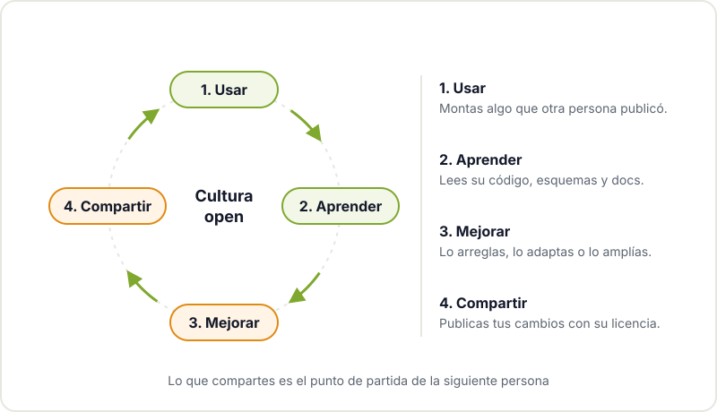
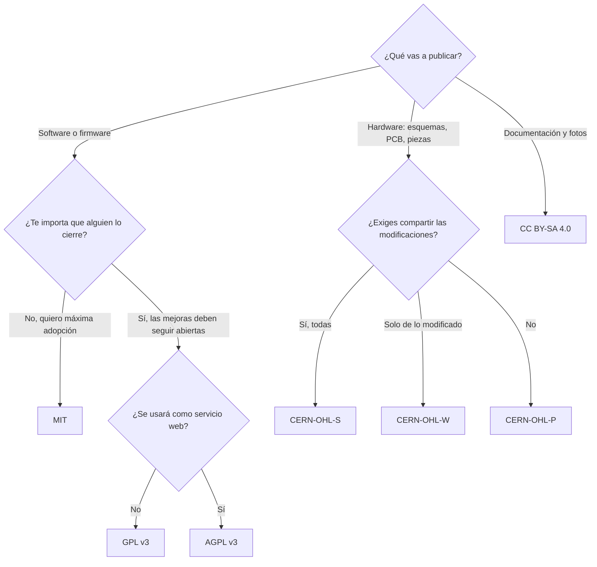
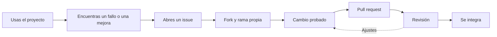

Casi todo lo que usas en el taller tiene detrás a alguien que decidió compartir su trabajo. El IDE con el que programas tu Arduino, la librería que lee tu sensor de temperatura, el footprint de KiCad que has usado en tu última PCB o el diseño de la impresora 3D que tienes en casa. Esa costumbre de publicar el código, los esquemas y la documentación para que cualquiera pueda usarlos, estudiarlos, modificarlos y redistribuirlos es lo que llamamos cultura open.

No es solo una cuestión de principios. En este post te contamos qué es el software libre y el hardware abierto, qué licencias vas a encontrarte y, sobre todo, qué ganas tú, en concreto, como maker, tanto usando proyectos abiertos como publicando los tuyos.

## Software libre y hardware abierto

El **software libre** parte de una idea sencilla: quien recibe un programa debe poder ejecutarlo, estudiar cómo funciona, modificarlo y compartir sus versiones. Para eso hace falta acceso al código fuente y una licencia que lo permita. El término "open source" nació después con un enfoque más pragmático, pero en la práctica cubre casi los mismos proyectos.

El **hardware abierto** lleva la misma idea a los objetos físicos. Como no puedes descargar una placa, lo que se comparte son sus fuentes de diseño: esquemas, ficheros de PCB, Gerbers, modelos 3D, lista de materiales e instrucciones de montaje. La [definición de hardware de código abierto de OSHWA](https://www.oshwa.org/definition/) (Open Source Hardware Association) recoge qué tiene que publicarse para que un diseño se considere abierto de verdad: los ficheros en el formato en el que se editan, no solo un PDF del esquema.

Algunos ejemplos que seguramente conoces:

- **Arduino.** Los diseños de referencia de sus placas se publicaron con licencia abierta. Por eso existen cientos de placas compatibles de otros fabricantes con el mismo pinout, y por eso cualquiera puede diseñar su propia variante. El nombre "Arduino" sí es una marca registrada, y esa es la razón por la que los clones se llaman de otra forma.
- **RepRap y Prusa.** El [proyecto RepRap](https://reprap.org/wiki/RepRap) nació en una universidad británica con el objetivo de crear una impresora 3D capaz de fabricar buena parte de sus propias piezas, y publicó todo bajo licencias libres. De esa comunidad salieron diseños como la Prusa Mendel y la Prusa i3, que a su vez inspiraron a buena parte de las impresoras domésticas actuales.
- **KiCad.** El programa de diseño electrónico que usamos en el [taller de KiCad](/workshops/kicad/) es software libre bajo GPL. Sus librerías de símbolos y footprints las mantiene en gran parte la comunidad.





## El ciclo que lo hace funcionar

La cultura open se sostiene con un ciclo que seguramente ya practicas sin ponerle nombre: usas algo que otra persona publicó, aprendes de cómo está hecho, lo mejoras para tu caso y compartes el resultado. Lo que publicas se convierte en el punto de partida de la siguiente persona.

## Las licencias que vas a encontrarte

Publicar algo sin licencia no lo hace abierto: por defecto, todos los derechos quedan reservados para su autor y nadie puede reutilizarlo legalmente. La licencia es lo que convierte un repositorio público en un proyecto que se puede usar. Estas son las más habituales en el mundo maker:

| Licencia | Tipo | Pensada para | Qué exige, en resumen |
|---|---|---|---|
| MIT | Permisiva | Software | Mantener el aviso de copyright y el texto de la licencia. Se puede usar en productos cerrados. |
| GPL v3 | Copyleft fuerte | Software | Si distribuyes una versión modificada, debe ir con su código fuente y bajo GPL. |
| AGPL v3 | Copyleft de red | Software que se ofrece como servicio web | Lo mismo que la GPL, y también cuando el programa se usa a través de la red sin distribuirlo. |
| CC BY-SA 4.0 | Copyleft (compartir igual) | Documentación, fotos, ilustraciones, diseños | Reconocer la autoría y publicar las obras derivadas con la misma licencia. |
| CERN-OHL v2 | Para hardware, en tres variantes (S, W y P) | Esquemas, PCB, piezas mecánicas | La variante S obliga a publicar las fuentes del diseño modificado; la W solo de las partes que modificas; la P es permisiva. |

Dos matices importantes. Las licencias Creative Commons no están pensadas para código, así que para el firmware usa una licencia de software. Y para hardware, las licencias de software encajan mal porque hablan de "código" y "compilar"; las [licencias CERN-OHL](https://cern-ohl.web.cern.ch/) se escribieron precisamente para diseños físicos.

### Cómo elegir licencia para tu proyecto

Si dudas, este esquema te sirve como punto de partida. Para más detalle, la guía [Choose a License](https://choosealicense.com/) compara las licencias de software más comunes en lenguaje claro.

Un proyecto maker completo suele combinar varias: por ejemplo, MIT o GPL para el firmware, CERN-OHL para la PCB y la carcasa, y CC BY-SA para la documentación y las fotos.

## Qué ganas tú, en concreto

Más allá de la filosofía, la cultura open tiene beneficios muy prácticos para cualquiera que monta cosas:

- **Aprendes del trabajo de otros.** Leer el firmware de un proyecto que funciona, o el esquema de una placa de desarrollo, enseña más que muchos tutoriales. Ves cómo resuelven el filtrado de la alimentación, cómo organizan el código o por qué colocan ese condensador junto a ese pin.
- **Puedes reparar.** Con los esquemas y el código fuente a mano, un aparato que falla deja de ser una caja negra. Puedes localizar el componente roto, actualizar un firmware abandonado por el fabricante o adaptar un repuesto. Cuando no hay documentación, toca hacer [ingeniería inversa de la PCB](/blog/ingenieria-inversa-pcb/), que es mucho más trabajo.
- **Reutilizas en vez de empezar de cero.** Un footprint ya verificado, una librería que gestiona el sensor o un soporte imprimible que encaja a la primera te ahorran horas y errores.
- **Construyes reputación.** Un repositorio con tus proyectos bien documentados dice más de ti que un currículum. Mucha gente ha encontrado trabajo o colaboradores gracias a lo que publicó.
- **Encuentras comunidad.** Cuando publicas, aparecen personas que usan tu proyecto, encuentran fallos que tú no veías y proponen mejoras. Es lo mismo que pasa en un [hackerspace](/blog/que-es-un-hackerspace/), pero a escala global.

## Cómo empezar a contribuir

No hace falta ser experto ni escribir código para aportar a un proyecto abierto. Estas son las formas más habituales, de menor a mayor esfuerzo:

1. **Abrir issues útiles.** Si algo falla, cuéntalo bien: qué placa y versión usas, qué esperabas, qué pasó y cómo reproducirlo. Un buen informe de fallo vale mucho.
2. **Mejorar la documentación.** Si te costó entender un paso del montaje, otra persona también lo sufrirá. Aclararlo, añadir una foto o corregir un pinout mal documentado es una contribución de primera.
3. **Traducir.** Muchos proyectos solo están en inglés. Traducir la interfaz o la guía de inicio abre el proyecto a mucha más gente.
4. **Enviar cambios (pull requests).** Corregir un fallo, añadir soporte para otra placa o un footprint nuevo. Lee antes la guía de contribución del proyecto y empieza por cambios pequeños.

## Esta web también es abierta

Predicamos con el ejemplo: el código de esta web se publica bajo licencia [AGPL v3](https://www.gnu.org/licenses/agpl-3.0.html), así que cualquiera puede estudiarlo, reutilizarlo y proponer mejoras, siempre que mantenga abiertos sus cambios. Lo encontrarás, junto con material de proyectos y talleres, en el [GitHub del Hackerspace Valencia](https://github.com/HackerspaceVLC/). Si ves una errata en un post o algo que no funciona en la web, abrir un issue o un pull request ahí es una forma estupenda de hacer tu primera contribución.

## Ven a compartir lo que haces

La cultura open se aprende practicando, y es mucho más fácil con gente alrededor. Pásate por el Hackerspace Valencia con ese proyecto que tienes a medias: te ayudamos a documentarlo, a elegirle licencia y a publicarlo. Echa un vistazo a nuestros [proyectos](/proyectos/) para ver lo que hemos construido en comunidad y, si quieres formar parte, [hazte socio o socia](/pages/alta/).

## Créditos de imágenes

Las fotografías proceden de [Wikimedia Commons](https://commons.wikimedia.org) y se utilizan bajo sus respectivas licencias:

- **Placa compatible con Arduino Uno** - *Arduino Uno board*, de JrawX - CC0 - [fuente](https://commons.wikimedia.org/wiki/File:Arduino_Uno_board.jpg)
- **Impresora Prusa i3** - *Prusa i3 3D Printer - Reprap - Completed*, de John Abella - CC BY 2.0 - [fuente](https://commons.wikimedia.org/wiki/File:Prusa_i3_3D_Printer_-_Reprap_-_Completed.jpg)
