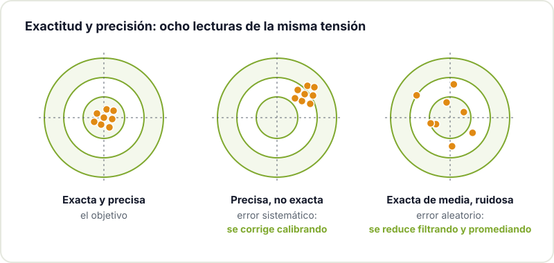
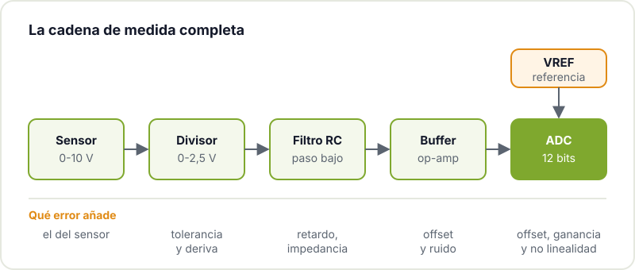
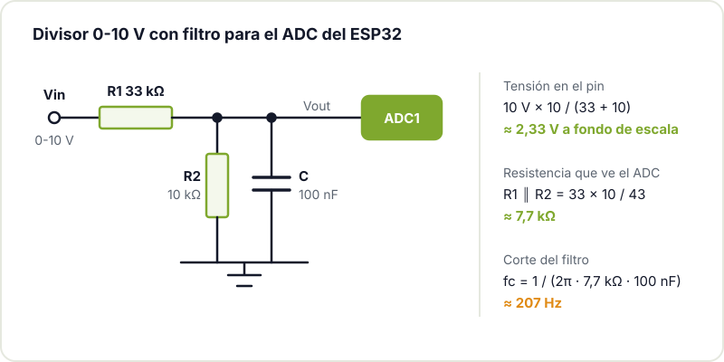
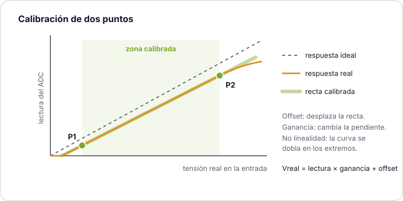

Conectas un potenciómetro o un sensor a una entrada analógica, llamas a `analogRead()` y aparece un número. Parece fácil hasta que te fijas: la lectura baila aunque no toques nada, no coincide con lo que marca el multímetro y cambia cuando se enciende la WiFi o el relé de al lado. La tentación es pensar que el ADC es malo y buscar uno con más bits. Casi nunca es la solución: un ADC de 16 bits mal acompañado mide peor que uno de 12 bits bien montado.

La precisión de una medida no la decide solo el conversor, sino toda la cadena que hay antes y después. Vamos a recorrerla.

## Lo básico: qué hace un ADC

El ADC compara la tensión de entrada con una tensión de referencia (VREF) y devuelve un número entero. Con N bits hay 2^N niveles posibles, y el código que obtienes es aproximadamente:

```text
código ≈ Vin / VREF × (2^N − 1)
```

El salto de tensión entre dos códigos consecutivos se llama LSB (bit menos significativo). Con una referencia de 3,3 V:

| Resolución | Niveles | 1 LSB a 3,3 V | Dónde lo encuentras |
|---|---|---|---|
| 8 bits | 256 | 12,9 mV | modos rápidos de algunos micros |
| 10 bits | 1024 | 3,22 mV | Arduino Uno y Nano (con 5 V de referencia, 4,9 mV) |
| 12 bits | 4096 | 0,81 mV | ESP32, RP2040, muchos STM32 |
| 16 bits | 65.536 | 0,05 mV | ADC externos como el ADS1115 |

Que un ESP32 distinga escalones de 0,8 mV no significa que mida con un error de 0,8 mV. Eso es **resolución**. La **exactitud** es lo cerca que estás del valor real, y la **precisión** (o repetibilidad) es lo poco que varían lecturas repetidas de la misma tensión. Son cosas distintas y se corrigen de forma distinta.



## De dónde sale el error

Un ADC real se separa del ideal por varios motivos:

- **Offset**: toda la respuesta está desplazada; con 0 V a la entrada no lees 0.
- **Ganancia**: la pendiente no es la correcta; el error crece a medida que sube la tensión.
- **No linealidad** (INL y DNL en los datasheets): la respuesta no es una recta perfecta. El ADC del ESP32 clásico es conocido por esto: pierde linealidad cerca de los extremos del rango.
- **Ruido**: la lectura fluctúa por interferencias, conmutación digital, fuentes de alimentación ruidosas.
- **Referencia**: si VREF se mueve, todas las medidas se mueven con ella.
- **Impedancia de la fuente, temperatura y diseño de la PCB**.

Y la cadena de medida añade los suyos antes de llegar al conversor:



## Una referencia estable

Todo lo que mide el ADC es relativo a VREF. Hay tres opciones habituales:

- **Referencia interna**: cómoda, pero su valor exacto varía de chip a chip y con la temperatura.
- **La propia alimentación** (lo que hace un Arduino Uno por defecto con sus 5 V): si los 5 V del USB bajan a 4,8 V, todas tus lecturas suben un 4 %.
- **Referencia externa de precisión**: un integrado dedicado da una tensión mucho más estable. En las placas Arduino que lo permiten se selecciona con `analogReference()`; la [referencia de analogRead de Arduino](https://docs.arduino.cc/language-reference/en/functions/analog-io/analogRead/) resume la resolución y el rango de cada placa.

Una buena referencia ayuda mucho, pero no arregla un montaje ruidoso ni una impedancia de entrada mal elegida.

## La impedancia importa

Dentro del ADC hay un condensador de muestreo (sample & hold) que tiene que cargarse en un tiempo muy corto. Si la fuente que lo alimenta tiene mucha resistencia, no le da tiempo y la lectura sale baja o arrastra parte del canal leído anteriormente. Por eso el datasheet del ATmega328P recomienda fuentes de unos 10 kΩ o menos. Las soluciones son bajar la impedancia del divisor, poner un condensador directamente en el pin que actúe de depósito de carga, o meter un buffer con un amplificador operacional.

## Ejemplo práctico: medir una señal de 0-10 V

Muchos sensores y equipos de taller dan una salida de 0-10 V. No puedes meterla directamente en un pin de 3,3 V, así que la reduces con un divisor resistivo:

```text
Vout = Vin × R2 / (R1 + R2)
```

| Caso | R1 | R2 | Vout con 10 V | R equivalente |
|---|---|---|---|---|
| ADC de 3,3 V, ajustado | 20 kΩ | 10 kΩ | 3,33 V (se pasa) | 6,7 kΩ |
| ADC de 3,3 V con margen | 22 kΩ | 10 kΩ | 3,13 V | 6,9 kΩ |
| ESP32 con atenuación máxima | 33 kΩ | 10 kΩ | 2,33 V | 7,7 kΩ |

El clásico 20k/10k deja la entrada justo al límite: cualquier pequeño sobrepico satura la lectura. En el ESP32 clásico además conviene no acercarse al techo del rango, porque es donde la respuesta se curva; con la atenuación máxima el rango recomendado ronda los 0,15-2,45 V. Por eso en ese caso tiene sentido apuntar a unos 2,3 V a fondo de escala.



Las resistencias tienen tolerancia (usa del 1 %) y deriva con la temperatura, y el divisor carga la señal que mides. Todo eso se compensa en gran parte con la calibración que veremos después.

## Filtra el ruido con un RC

Un filtro paso bajo RC elimina el ruido de alta frecuencia antes de que llegue al ADC. Su frecuencia de corte es:

```text
fc = 1 / (2π × R × C)
```

Con R = 1 kΩ y C = 100 nF, fc ≈ 1,59 kHz. En el divisor del ejemplo, la R del filtro es la resistencia equivalente del propio divisor (7,7 kΩ), así que con 100 nF el corte queda en unos 207 Hz: de sobra para una temperatura o una tensión que cambia despacio. Espressif recomienda precisamente un condensador de 100 nF en el pin del ADC en su [guía de calibración del ADC](https://docs.espressif.com/projects/esp-idf/en/stable/esp32/api-reference/peripherals/adc/adc_calibration.html). Si quieres repasar la teoría, la página de Wikipedia sobre el [filtro RC](https://es.wikipedia.org/wiki/Filtro_RC) lo explica bien. No te pases filtrando: si la señal tiene información rápida, un corte demasiado bajo se la come.

## Alimentación, masa y PCB

El microcontrolador conmuta corrientes constantemente y la WiFi del ESP32 mete picos importantes. Ese ruido viaja por la alimentación y la masa hasta tu medida. Algunas reglas:

- Condensadores de desacoplo pegados a los pines de alimentación.
- Pistas analógicas cortas y lejos de reguladores conmutados, relés y la antena.
- Plano de masa continuo, sin cortes que obliguen a las corrientes de retorno a dar vueltas.
- En el ESP32, usa canales del ADC1: el ADC2 lo comparte la WiFi.

Una medida analógica buena empieza en el layout. Si estás diseñando tu placa, repasa los [errores típicos en PCBs con ESP32](/blog/errores-pcb-esp32/).

## Promedia y calibra en el firmware

Promediar N lecturas reduce el ruido aleatorio aproximadamente en √N: con 64 muestras, ocho veces menos. Ojo: promediar no convierte un ADC de 12 bits en uno de 16 ni corrige el offset o la ganancia; para eso está la calibración.

La **calibración de dos puntos** corrige offset y ganancia a la vez. Aplicas a la entrada dos tensiones conocidas (medidas con un buen multímetro), una cerca del extremo bajo y otra cerca del alto, anotas la lectura media del ADC en cada una y calculas la recta que pasa por ellas:

```text
Vreal = lectura × ganancia + offset
```



Este sketch para Arduino o ESP32 hace las dos cosas:

```cpp
const int PIN_ADC = 34;   // GPIO34 es un canal del ADC1 en el ESP32
const int N = 64;         // muestras por lectura

// Puntos de calibración: tensión real en la entrada 0-10 V (multímetro)
// y lectura media del ADC en ese momento. Sustitúyelos por los tuyos.
const float V1 = 1.00, L1 = 270.0;
const float V2 = 9.00, L2 = 2560.0;
const float GANANCIA = (V2 - V1) / (L2 - L1);
const float OFFSET = V1 - GANANCIA * L1;

float lecturaMedia(int pin, int n) {
  uint32_t suma = 0;
  for (int i = 0; i < n; i++) {
    suma += analogRead(pin);
    delayMicroseconds(50);
  }
  return (float)suma / n;
}

void setup() {
  Serial.begin(115200);
  analogReadResolution(12);  // ESP32, RP2040 o SAMD; en un Uno no existe
}

void loop() {
  float lectura = lecturaMedia(PIN_ADC, N);
  float vin = lectura * GANANCIA + OFFSET;
  Serial.print("lectura=");
  Serial.print(lectura, 1);
  Serial.print("  Vin=");
  Serial.print(vin, 3);
  Serial.println(" V");
  delay(500);
}
```

Para calibrar, carga el sketch con unos valores provisionales, aplica 1 V y 9 V con una fuente de laboratorio, apunta la lectura media de cada caso y cámbialos en `L1` y `L2`. Si necesitas más exactitud en todo el rango, puedes usar varios puntos y una tabla de corrección.

En el ESP32 tienes además ayuda de fábrica: cada chip trae datos de calibración grabados en sus eFuses. En ESP-IDF, el [driver de ADC oneshot](https://docs.espressif.com/projects/esp-idf/en/stable/esp32/api-reference/peripherals/adc/adc_oneshot.html) junto con el de calibración convierten la lectura bruta en milivoltios usando esos datos, y en el core de Arduino para ESP32 la función `analogReadMilliVolts()` hace algo parecido. Es un buen punto de partida, pero si necesitas exactitud con tu divisor y tus resistencias, la calibración de dos puntos sobre el montaje completo sigue siendo la que manda.

## Buffer y protección

Un amplificador operacional como seguidor de tensión tiene impedancia de entrada altísima y de salida muy baja: aísla la fuente del condensador de muestreo. A cambio añade su propio offset, ruido y deriva, y no todos llegan hasta los raíles de alimentación, así que elige uno *rail-to-rail* y que trabaje con tu tensión.

Si la señal viene de fuera de la caja (un cable largo, un equipo del taller), protégela: resistencia en serie, diodos de clamping o un TVS. Cuida que la protección no meta más error del que evita: una resistencia serie grande también ralentiza la carga del condensador de muestreo.

## Checklist antes de cambiar de microcontrolador

- ¿La referencia es estable o depende del USB?
- ¿La impedancia que ve el ADC es razonable o hay un condensador en el pin?
- ¿Hay un filtro RC adecuado a la velocidad de la señal?
- ¿La alimentación está bien desacoplada y la masa es continua?
- ¿Estás promediando lo suficiente?
- ¿Has calibrado con el montaje completo?
- En el ESP32: ¿usas ADC1 y te mantienes lejos de los extremos del rango?

Si todo eso está bien y aún te falta exactitud, entonces sí: un ADC externo de más bits con su propia referencia tiene sentido.

## Ven a medirlo con nosotros

Si tienes una medida que no cuadra, tráete el montaje al [Hackerspace Valencia](/blog/que-es-un-hackerspace/) y lo revisamos juntos con multímetro y osciloscopio. Si estás alimentando el sensor desde una batería, te interesará también [cómo calcular la autonomía real de un nodo IoT](/blog/autonomia-real-bateria-iot/), y si el siguiente paso es tu propia placa, nuestro [taller de KiCad](/workshops/kicad/) es el sitio para empezar.

## Créditos de imágenes

- **Portada** - *Aneng AN870 multimeter 01* - Retired electrician - CC0 - [fuente](https://commons.wikimedia.org/wiki/File:Aneng_AN870_multimeter_01.jpg)
- Diagramas: elaboración propia del Hackerspace Valencia.
