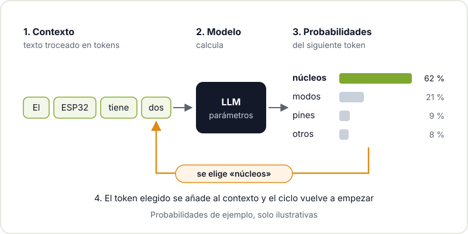
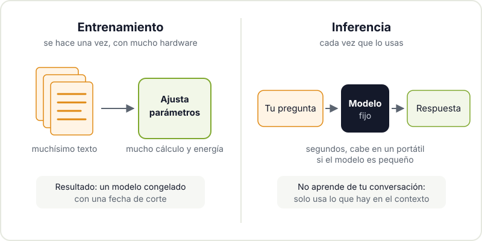
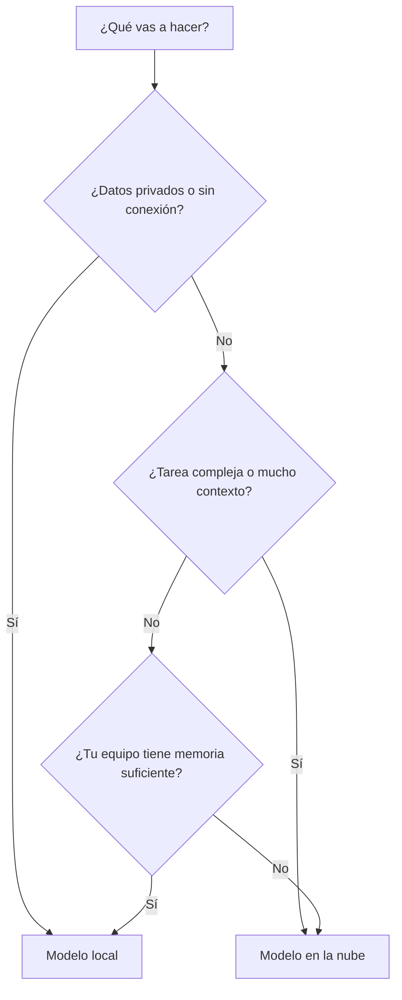

Entre titulares que prometen que la IA lo va a hacer todo y otros que aseguran que es una burbuja, cuesta saber qué es exactamente eso que usas cuando le pides a un chat que te explique un error de compilación. En este post vamos a quitarle el humo: qué hace una [IA generativa](https://es.wikipedia.org/wiki/Inteligencia_artificial_generativa) por dentro, por qué a veces se inventa cosas con total seguridad, qué diferencia hay entre los modelos de texto y los de imágenes, y para qué te puede servir de verdad en un proyecto maker.

No hace falta saber matemáticas para seguirlo. Sí ayuda tener la misma actitud que con cualquier herramienta del taller: entender cómo funciona para saber cuándo usarla y cuándo no.

## Un modelo que predice el siguiente token

Un [modelo de lenguaje grande](https://es.wikipedia.org/wiki/Modelo_extenso_de_lenguaje) (LLM, por sus siglas en inglés) hace, en el fondo, una sola cosa: dado un texto, calcula qué fragmento es más probable que venga a continuación. Elige uno, lo añade al texto y repite. Así, fragmento a fragmento, construye la respuesta completa.

Esos fragmentos se llaman **tokens**. Un token puede ser una palabra corta, un trozo de palabra, un signo de puntuación o un espacio. Palabras frecuentes suelen ser un solo token; palabras raras, nombres de componentes o código se parten en varios. Por eso los límites de los modelos se miden en tokens y no en palabras.



Lo importante de este esquema es lo que **no** aparece en él: no hay una base de datos de hechos que el modelo consulte, ni un paso en el que compruebe si lo que dice es cierto. Hay un cálculo de probabilidades muy sofisticado, aprendido a partir de muchísimo texto, que resulta producir respuestas útiles con mucha frecuencia. Pero es eso: probabilidades.

## Entrenamiento e inferencia: dos fases muy distintas

Conviene separar dos momentos en la vida de un modelo:

- **Entrenamiento**: el modelo ajusta sus parámetros (miles de millones de números) leyendo enormes cantidades de texto y aprendiendo a predecir el siguiente token. Es carísimo en cálculo y energía, se hace una vez (más algunos ajustes posteriores) y lo hacen organizaciones con mucho hardware. Al terminar, el modelo queda congelado: lo que sabe del mundo se corta en esa fecha.
- **Inferencia**: es lo que pasa cada vez que usas el modelo. Los parámetros ya no cambian; solo se ejecuta el cálculo para generar tu respuesta. Es mucho más barato y, con modelos pequeños, cabe en un portátil.



Una consecuencia práctica: el modelo no aprende de lo que le cuentas en una conversación. Si parece que "recuerda", es porque la aplicación le vuelve a pasar el historial en cada mensaje.

## Tokens y ventana de contexto

Todo lo que el modelo tiene en cuenta para responder cabe en su **ventana de contexto**: tus instrucciones, el historial de la conversación, los ficheros que le pegues y la propia respuesta que va generando. Esa ventana tiene un tamaño máximo en tokens que depende del modelo.

Si te pasas, lo más antiguo se recorta o la aplicación lo resume, y el modelo "olvida" detalles. Además, aunque quepa, un contexto enorme y desordenado da peores respuestas que uno corto y relevante. Pegar las dos páginas del datasheet que importan funciona mejor que pegar las trescientas.

## Por qué alucinan

Una [alucinación](https://es.wikipedia.org/wiki/Alucinaci%C3%B3n_(inteligencia_artificial)) es una respuesta que suena convincente pero es falsa: una función de librería que no existe, un pin que no corresponde a tu placa, una cita inventada. Con lo visto hasta ahora se entiende por qué ocurre:

- El modelo genera lo **plausible**, no lo **verificado**. Si en su entrenamiento ha visto muchas librerías con funciones parecidas, una función inventada con ese estilo es muy probable.
- No sabe lo que no sabe. No tiene un mecanismo fiable para decir "esto no lo tengo claro" salvo que se le haya entrenado o pedido explícitamente.
- Su conocimiento tiene fecha de corte. Una placa o una versión de librería posterior al entrenamiento simplemente no existe para él.

La forma de reducirlas es darle fuentes (el datasheet, el código real, la documentación) y comprobar el resultado con algo que no sea el propio modelo: el compilador, el multímetro o la documentación oficial.

## Texto e imágenes: LLM frente a modelos de difusión

No todas las IA generativas funcionan igual. Los modelos de texto que hemos visto generan token a token. Los generadores de imágenes más extendidos usan otra técnica, los [modelos de difusión](https://es.wikipedia.org/wiki/Modelo_de_difusi%C3%B3n): parten de una imagen de ruido aleatorio y la van "limpiando" en muchos pasos, guiados por la descripción que les das, hasta que aparece una imagen coherente.

| | LLM (texto) | Difusión (imagen) |
|---|---|---|
| Cómo genera | Token a token, de izquierda a derecha | De ruido a imagen, en muchos pasos de refinado |
| Entrada típica | Texto, código, a veces imágenes | Descripción en texto, a veces una imagen base |
| Fallo típico | Datos inventados con seguridad | Detalles imposibles: textos ilegibles, piezas que no encajan |
| Uso maker | Explicar, programar, documentar | Bocetos, ideas de diseño, texturas |

Ojo con las imágenes generadas en proyectos de fabricación: un render bonito de una carcasa no es un modelo 3D con medidas. Sirve para inspirarte, no para mandarlo a la impresora.

## Modelos locales o en la nube

Puedes usar un modelo de dos formas: a través de un servicio en la nube o ejecutándolo en tu propio equipo. Herramientas como [Ollama](https://ollama.com/) y [llama.cpp](https://github.com/ggml-org/llama.cpp) permiten descargar modelos abiertos y ejecutarlos en local, normalmente en versiones "cuantizadas" que ocupan menos memoria a cambio de algo de precisión.

```bash
# Con Ollama: descarga un modelo y abre un chat en la terminal
ollama pull nombre-del-modelo
ollama run nombre-del-modelo "Explícame qué hace un pull-up en I2C"

# Con llama.cpp: ejecuta un modelo en formato GGUF
llama-cli -m modelo.gguf -p "Resume este datasheet en cinco puntos"
```



La regla general: los modelos locales te dan privacidad, funcionan sin internet y no tienen coste por uso, pero los que caben en un equipo doméstico son más limitados. Los servicios en la nube ofrecen modelos más capaces, a cambio de enviar tus datos fuera y, normalmente, pagar por uso. Lo sensato es probar ambos y elegir según la tarea, no por fidelidad a una marca.

## Usos que sí funcionan en el taller

Después de tanto aviso, la parte buena: bien usada, una IA generativa ahorra mucho tiempo en un proyecto maker.

- **Explicar datasheets.** Pégale la sección relevante y pregúntale qué registro configura el modo de bajo consumo o qué significa una tabla de tiempos. Luego comprueba la respuesta en el propio datasheet.
- **Generar código, revisándolo.** Un primer borrador de la lectura de un sensor por I2C, un script para procesar los datos de tu estación meteorológica o una función para un ESP32. Léelo entero, compílalo y pruébalo antes de fiarte. Si estás empezando a programar, pídele que te lo explique línea a línea en vez de copiarlo sin más.
- **Documentar proyectos.** Generar un primer README, comentar funciones o redactar instrucciones de montaje a partir de tus notas. Es la parte que casi nadie hace y la que más agradece la comunidad.
- **Depurar con contexto.** Pegarle el error completo y el fragmento de código implicado suele dar mejores pistas que buscar el mensaje de error a ciegas.

También hay IA más allá de los grandes modelos: si te interesa ejecutar redes neuronales pequeñas directamente en un microcontrolador, echa un vistazo a nuestro post sobre [TinyML en microcontroladores](/blog/tinyml-microcontroladores/). Y si quieres dar el salto de un chat que responde a un sistema que actúa sobre tus ficheros, sigue con [qué es un agente de IA](/blog/que-es-un-agente-ia/).

## Límites y buenas prácticas

- **Verifica todo lo que importa.** Pines, tensiones, valores de componentes y cualquier dato que pueda quemar algo o hacerte daño se comprueban en la documentación oficial.
- **Dale fuentes, no solo preguntas.** Cuanto más relevante sea el contexto, menos inventa.
- **Cuida lo que pegas.** No metas contraseñas, claves de API ni datos personales en un servicio externo.
- **No delegues el aprendizaje.** Si quieres aprender electrónica, que la IA te explique, pero haz tú el circuito.
- **Respeta las licencias.** El código generado puede parecerse a código existente. En un proyecto que vas a publicar, revisa qué estás incluyendo.

## Ven a hablarlo al hackerspace

La IA generativa es una herramienta más del taller, como el soldador o la impresora 3D: útil cuando sabes cómo funciona y peligrosa cuando no. Si quieres probarla en un proyecto real, pásate por el Hackerspace Valencia con tu portátil: alguien de la comunidad estará trasteando con modelos locales, programando con ayuda de IA o discutiendo justo sus límites. Y si quieres pasar al siguiente nivel, apúntate al [taller de IA agéntica](/workshops/taller-ia-agentica/). Si es tu primera vez, empieza por [qué es un hackerspace](/blog/que-es-un-hackerspace/).

## Créditos de imágenes

La fotografía de portada procede de [Wikimedia Commons](https://commons.wikimedia.org) y se utiliza bajo su licencia:

- **Portada** - *Datacenter Server Racks* - Carl Lender - CC BY 2.0 - [fuente](https://commons.wikimedia.org/wiki/File:Datacenter_Server_Racks_(22370909788).jpg)
