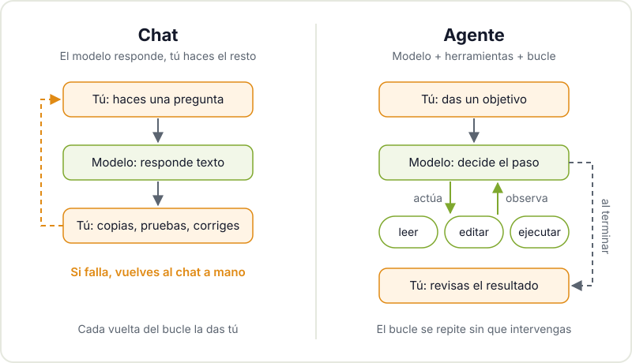
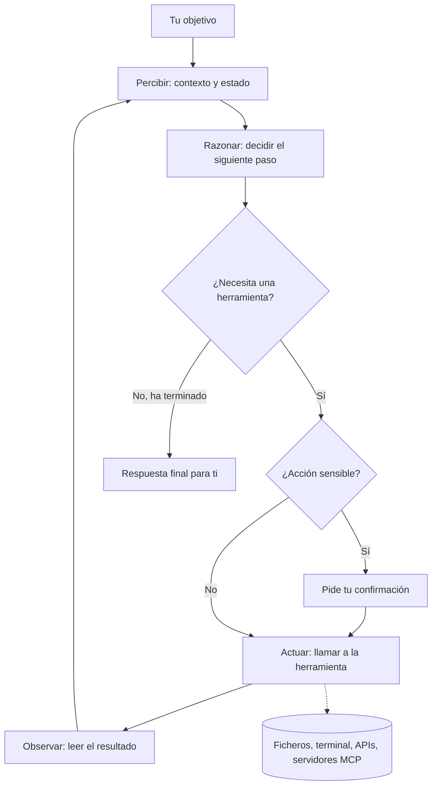
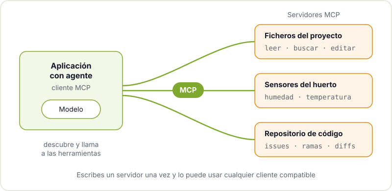

Llevas tiempo pidiéndole cosas a un chat de IA: que te explique un error de compilación, que te escriba una función para leer un sensor, que te resuma un datasheet. Funciona, pero el trabajo de verdad lo sigues haciendo tú: copias el código, lo pegas en tu proyecto, compilas, ves que falla, vuelves al chat con el error y repites. Un agente de IA es el paso siguiente: un sistema que no solo responde, sino que actúa, mira el resultado y decide qué hacer después.

En este post te contamos qué hay debajo de esa palabra, que se ha puesto de moda y se usa para casi todo, y cuándo te compensa usar un agente en tus proyectos y cuándo no.

## De chatbot a agente

Un chat de IA es, en esencia, un modelo de lenguaje al que le das texto y te devuelve texto. Si todavía no tienes claro qué hace exactamente ese modelo, empieza por [qué es realmente una IA generativa](/blog/que-es-la-ia-generativa/). Lo importante aquí es que el chat no toca nada: no abre tus ficheros, no ejecuta comandos, no sabe si lo que te ha sugerido compila.

Un agente añade dos piezas a ese modelo:

- **Herramientas**: funciones que el modelo puede pedir que se ejecuten. Leer un fichero, buscar en un repositorio, lanzar un comando en la terminal, hacer una petición a una API o consultar una base de datos.
- **Un bucle**: el programa que envuelve al modelo le pasa el objetivo, ejecuta la herramienta que el modelo pide, le devuelve el resultado y vuelve a preguntarle qué hacer. Así hasta que el modelo considera que ha terminado o hasta que se alcanza algún límite.

Dicho de forma corta: **agente = modelo + herramientas + bucle**. El modelo sigue siendo el mismo tipo de modelo que usa un chat. Lo que cambia es todo lo que hay alrededor.

## El bucle: percibir, razonar, actuar, observar

La literatura clásica de IA ya hablaba de [agentes inteligentes](https://es.wikipedia.org/wiki/Agente_inteligente_(inteligencia_artificial)) mucho antes de los modelos de lenguaje: algo que percibe su entorno y actúa sobre él. Los agentes actuales siguen ese esquema con cuatro fases que se repiten:

1. **Percibir**: el agente reúne el contexto. Tu petición, las instrucciones del proyecto, los ficheros que ha leído y los resultados de los pasos anteriores.
2. **Razonar**: el modelo decide el siguiente paso. Puede ser "necesito ver cómo está definido este pin" o "ya tengo suficiente, voy a proponer el cambio".
3. **Actuar**: si el paso requiere una herramienta, el modelo genera una llamada estructurada (por ejemplo, "ejecuta este comando") y el programa que lo envuelve la ejecuta.
4. **Observar**: el resultado de la herramienta, sea la salida del compilador o el contenido de un fichero, vuelve al contexto del modelo y el ciclo empieza otra vez.

Fíjate en el nodo de confirmación: un buen agente no ejecuta a ciegas cualquier cosa. Volveremos a ello en la parte de riesgos.

## Ejemplos que tienen sentido en un taller

Los agentes más maduros hoy son los de programación, porque el código es texto, las herramientas son claras (leer, editar, compilar, ejecutar tests) y el resultado se puede comprobar. Algunos usos que encajan con proyectos maker:

- **Un agente que lee tu repositorio y propone cambios.** Le pides "añade un modo de bajo consumo al firmware y explica qué has tocado". El agente busca dónde se inicializa la radio, lee la configuración, edita los ficheros, compila y, si hay errores, los corrige. Tú revisas el diff al final, como revisarías el de un compañero. Si te interesa el tema del bajo consumo, tenemos una guía sobre [cómo reducir el consumo del ESP32](/blog/consumo-esp32/) que te sirve para validar lo que el agente proponga.
- **Un agente que consulta tus sensores.** Si tienes una estación meteorológica o un huerto con sensores publicando datos, puedes exponer esos datos como herramienta. Le preguntas "¿ha bajado la humedad del suelo esta semana?" y el agente consulta la serie, compara y te responde con datos reales en lugar de inventárselos.
- **Un agente que documenta.** Recorre el proyecto, lee el código y los esquemas exportados y redacta un README con instrucciones de montaje. Lo revisas y corriges, pero te ahorra la parte más tediosa.

En todos los casos el valor está en lo mismo: el agente puede comprobar su propio trabajo con herramientas, en vez de quedarse en una respuesta plausible.

## Model Context Protocol: un enchufe estándar para herramientas

Si cada agente tuviera que implementar a mano su forma de hablar con tu base de datos, tu sistema de ficheros o tu Home Assistant, sería un caos. Para eso existe el [Model Context Protocol (MCP)](https://modelcontextprotocol.io/), un protocolo abierto que define cómo un agente descubre y usa herramientas y fuentes de datos externas.

La idea se parece a la de un puerto USB: escribes un **servidor MCP** una vez, por ejemplo uno que expone "leer temperatura" y "leer humedad" de tus sensores, y cualquier aplicación compatible con MCP puede usarlo, sin depender de un proveedor concreto. Hay servidores MCP ya hechos para sistemas de ficheros, bases de datos, navegadores o repositorios de código, y escribir uno propio para tu proyecto es un buen ejercicio de fin de semana.

Otra pieza útil es dar al agente instrucciones persistentes sobre tu proyecto. Una convención extendida es el fichero [AGENTS.md](https://agents.md/), un README pensado para agentes: cómo se compila, cómo se lanzan los tests, qué convenciones sigue el código y qué no se debe tocar.

## Riesgos: permisos, confirmaciones y coste

Un agente que puede actuar también puede equivocarse actuando. Antes de darle acceso a nada, piensa en estos tres frentes.

### Permisos

Dale solo lo que necesita. Si la tarea es editar el firmware, no hace falta que tenga acceso a tus claves SSH ni a internet sin restricciones. Trabaja en una copia o en una rama de Git, para que cualquier cambio sea reversible. Ojo también con el contenido que lee: un fichero o una web pueden incluir instrucciones maliciosas que el modelo confunda con las tuyas. Es el problema de la inyección de prompts, que encabeza el [Top 10 de riesgos de aplicaciones con LLM de OWASP](https://genai.owasp.org/llm-top-10/).

### Confirmar acciones

Separa lo que el agente puede hacer solo (leer, buscar, compilar) de lo que requiere tu visto bueno (borrar ficheros, hacer push, enviar mensajes, mover un motor o activar un relé). Si el agente controla hardware físico, la confirmación no es opcional: un error de software que activa una resistencia calefactora no se arregla con un `git revert`.

### Coste

Cada vuelta del bucle es una llamada al modelo con todo el contexto acumulado. Una tarea que en un chat serían dos mensajes puede convertirse en decenas de llamadas. Si usas un modelo de pago, pon límites de pasos o de gasto. Si usas modelos locales, el coste se traslada a tiempo y a consumo de tu equipo. En ambos casos conviene elegir el modelo más modesto que resuelva bien cada tarea.

## Cuándo no usar un agente

Un agente no siempre es la mejor herramienta. Probablemente no te compensa cuando:

- **La tarea es una pregunta.** Si quieres entender qué hace un registro del microcontrolador, un chat (o el datasheet) es más rápido y barato.
- **No puedes verificar el resultado.** Si no hay tests, ni compilación, ni forma de comprobar que el cambio funciona, el agente no tiene con qué corregirse y tú tampoco sabrás si ha acertado.
- **La acción es irreversible o peligrosa.** Tensión de red, maquinaria, datos personales o dinero. Ahí manda una persona con criterio.
- **Quieres aprender.** Si tu objetivo es entender cómo funciona el I2C, dejar que un agente lo resuelva por ti te quita justo la parte que te interesa. Úsalo para que te explique, no para que lo haga.
- **El proceso ya es determinista.** Si un script de diez líneas o una regla de `make` resuelve el problema siempre igual, no metas un modelo en medio.

## Ven a probarlo con nosotros

La mejor forma de entender un agente es ver la misma tarea resuelta primero en un chat y después con un agente, y comparar. Eso es exactamente lo que hacemos en el [taller de IA desde cero a programar con IA agéntica](/workshops/taller-ia-agentica/), abierto y gratuito, donde veremos el bucle, las herramientas, MCP y cómo trabajar con varios agentes a la vez sin perder el control ni el presupuesto.

Si prefieres trastear a tu ritmo, pásate por el Hackerspace Valencia con tu portátil y tu proyecto. Seguro que alguien de la comunidad está peleándose con lo mismo. Y si quieres saber cómo funcionamos, empieza por [qué es un hackerspace](/blog/que-es-un-hackerspace/).

## Créditos de imágenes

La fotografía de portada procede de [Wikimedia Commons](https://commons.wikimedia.org) y se utiliza bajo su licencia:

- **Portada** - *Macro laptop coding (Unsplash)* - Marc Mueller - CC0 - [fuente](https://commons.wikimedia.org/wiki/File:Macro_laptop_coding_(Unsplash).jpg)
