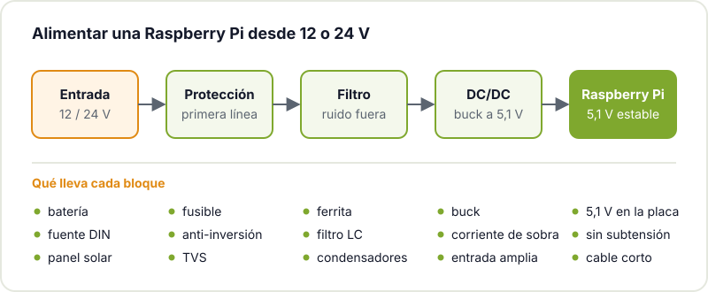
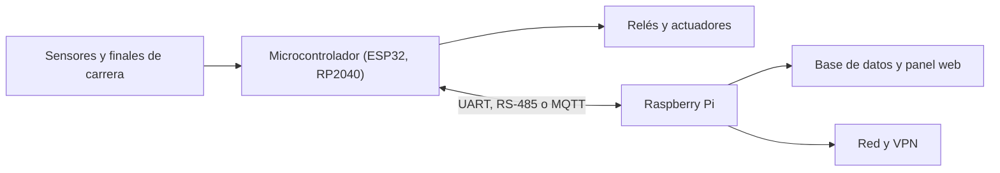

En la mesa funciona todo: la Raspberry Pi arranca, el script lee los sensores, Home Assistant responde. Luego la metes en una caja en el garaje, en el invernadero o en el cuadro eléctrico de casa, y a las tres semanas deja de contestar. Al reiniciarla, la microSD está corrupta. O se reinicia sola cada vez que arranca el compresor. O en agosto va a la mitad de velocidad.

No es que la Pi sea mala para estar encendida siempre. Es que el banco de trabajo y el sitio final son entornos muy distintos, y lo que decide si aguanta es cómo montas el sistema alrededor de la placa. Esta guía repasa los puntos que más fallan y cómo resolverlos con medios de taller.

## Alimentación: el origen de casi todo

La mayoría de cuelgues raros vienen de la alimentación. En la mesa usas el cargador oficial con un cable corto; en el sitio final aparecen fuentes baratas, cables largos y finos, cargas que arrancan y paran, y a veces una batería o un panel solar de 12 V.

La Pi quiere 5,1 V estables y con margen de corriente: la fuente oficial de la Pi 4 da 3 A, y la de la Pi 5 llega a 5 A. Cuando la tensión cae por debajo de lo que necesita, el firmware lo registra como subtensión. Compruébalo con:

```bash
vcgencmd get_throttled
```

Si devuelve algo distinto de `throttled=0x0`, ha habido subtensión, limitación de frecuencia o temperatura excesiva desde el arranque. Un valor distinto de cero en una instalación que lleva días funcionando es la primera pista cuando algo falla de forma intermitente.

Si en el sitio tienes 12 o 24 V (una batería de coche, una fuente de carril DIN, un sistema solar), no te limites a enchufar un convertidor de los baratos. Monta una cadena completa:



- **Protección**: un fusible, un diodo o un MOSFET contra polaridad inversa (alguien acabará conectando los cables al revés) y un diodo TVS que se coma los picos.
- **Filtro**: una ferrita o una bobina con condensadores en la entrada para que el ruido de motores y relés no llegue al convertidor.
- **DC/DC**: un convertidor buck, no un regulador lineal. Bajar de 24 V a 5 V a 3 A con un LDO significa disipar unos 57 W en calor, algo inviable. Lo explicamos en detalle en [LDO vs DC/DC](/blog/ldo-vs-dc-dc/). Elige uno con margen de corriente y con un rango de entrada que cubra las subidas de la batería mientras carga.

Y lleva los 5 V a la placa con cable corto y de sección generosa: con cables finos, la caída de tensión en los picos de consumo basta para provocar subtensión.

## La microSD: reduce las escrituras

Las microSD tienen un número limitado de ciclos de escritura, y un sistema Linux escribe constantemente: logs, cachés, bases de datos, swap. A eso súmale los cortes de luz: si se va la corriente mientras se escribe, el sistema de archivos puede quedar corrupto.

Estrategias, de menos a más esfuerzo:

| Medida | Qué consigue |
|---|---|
| Tarjeta de calidad, de tipo *high endurance* o industrial | Aguanta muchos más ciclos de escritura |
| [log2ram](https://github.com/azlux/log2ram) | Lleva `/var/log` a RAM y lo vuelca a la tarjeta de vez en cuando |
| Desactivar la swap y montar `/tmp` en RAM | Elimina escrituras que no aportan nada |
| Guardar datos en lotes y no cada segundo | Menos escrituras pequeñas y repetidas |
| Overlay de solo lectura | La tarjeta no se escribe; los cambios viven en RAM y se pierden al reiniciar |
| Arrancar desde un SSD por USB (o NVMe en la Pi 5) | Almacenamiento mucho más resistente |

El overlay de solo lectura es la opción más robusta para un aparato que siempre hace lo mismo, como un panel o una pasarela de sensores. `raspi-config` incluye una opción de *Overlay File System* que lo activa sin complicaciones; la [documentación de configuración de Raspberry Pi](https://www.raspberrypi.com/documentation/computers/configuration.html) describe la herramienta. Si necesitas guardar datos, mándalos a otro sitio (un servidor, una base de datos en red, un USB dedicado) y deja el sistema intacto.

Y ten siempre una imagen de la tarjeta lista para grabar. Cuando falle, tardarás cinco minutos en recuperarla en lugar de una tarde.

## Temperatura: cuidado con las cajas cerradas

Sobre la mesa la Pi respira. Dentro de una caja estanca en un invernadero al sol o en un cuarto de máquinas, no. Cuando el SoC se calienta demasiado, el firmware baja la frecuencia del procesador para protegerse: según la [documentación oficial de Raspberry Pi](https://www.raspberrypi.com/documentation/computers/raspberry-pi.html), entre 80 y 85 °C empieza a limitarse de forma progresiva. Si tu aplicación usa visión, IA local o muchos servicios a la vez, lo notarás.

Mide antes de decidir:

```bash
vcgencmd measure_temp
```

Las soluciones típicas: una caja de aluminio que actúe de disipador (como la de la foto de portada), un ventilador con control por temperatura, agujeros de ventilación pensados (entrada abajo, salida arriba) y no colocar la caja donde le dé el sol directo. Si la caja tiene que ser estanca, que el disipador saque el calor a través de la pared.

## Watchdog: que se recupere sola

Algo acabará colgándose: el kernel, un driver o tu propio programa. La Pi tiene un watchdog por hardware que reinicia la placa si nadie le da señales de vida durante un tiempo. Con systemd lo activas en `/etc/systemd/system.conf`:

```ini
[Manager]
RuntimeWatchdogSec=10s
```

Con esto, si el sistema se bloquea por completo, se reinicia solo. La [API de watchdog del kernel Linux](https://www.kernel.org/doc/html/latest/watchdog/watchdog-api.html) explica el mecanismo. Para tu aplicación, configura el servicio de systemd con `Restart=always` para que vuelva a arrancar si se cae. Y recuerda que la Pi arranca sola cuando vuelve la luz tras un corte; asegúrate de que tu programa también lo hace.

## Actualizaciones y seguridad

Una Pi conectada a la red durante años es un objetivo. Lo mínimo:

- Acceso SSH solo con clave, sin contraseña, y sin usuario por defecto.
- Nada de abrir puertos en el router. Si necesitas acceso remoto, usa una VPN como WireGuard.
- Actualizaciones de seguridad regulares. El paquete `unattended-upgrades` de Debian las automatiza, pero en un sistema crítico quizá prefieras actualizar a mano y comprobar que todo sigue funcionando.
- Separa los aparatos de domótica en su propia red o VLAN si tu router lo permite.

Y guarda la configuración (scripts, ficheros de servicio, `docker-compose.yml`) en un repositorio. Si tienes que montar otra Pi desde cero, lo harás en minutos.

## Conectar señales de 12 y 24 V

Los GPIO de la Raspberry Pi trabajan a 3,3 V y no toleran tensiones mayores. En el taller, el invernadero o una instalación de riego encontrarás sensores, finales de carrera y electroválvulas a 12 o 24 V. Nunca los conectes directamente:

- **Entradas digitales**: un optoacoplador separa eléctricamente el circuito de campo de la Pi. Si el cable es largo o pasa cerca de motores, el aislamiento galvánico te ahorrará muchos disgustos.
- **Salidas**: relés o MOSFET con su diodo de libre circulación en cargas inductivas.
- **Señales analógicas** (0-10 V, 4-20 mA): la Pi no tiene ADC, así que necesitas uno externo con su acondicionamiento. Lo contamos en [cómo mejorar la precisión del ADC](/blog/precision-adc-microcontrolador/).
- **Buses de campo** como RS-485 o CAN: con un transceptor, mejor aislado.

## Pi para pensar, microcontrolador para actuar

La Pi tarda segundos en arrancar, Linux no garantiza tiempos de respuesta exactos y una actualización puede dejarla reiniciando en el peor momento. Para tareas que deben responder siempre y al instante (cortar el riego, parar un motor, una alarma), un microcontrolador es más fiable. La arquitectura que mejor funciona en muchos proyectos combina los dos:



El microcontrolador se encarga del control en tiempo real y de los modos seguros: si la Pi se reinicia o pierde la red, el riego no se queda abierto. La Pi aporta lo que hace bien: almacenamiento, interfaz web, comunicaciones, procesado pesado y actualizaciones. Si el microcontrolador es un ESP32, puedes actualizarlo también a distancia, como contamos en [actualizaciones OTA en el ESP32](/blog/actualizaciones-ota-esp32/).

## Checklist antes de dejarla sola

- Fuente con margen y `vcgencmd get_throttled` a cero tras varios días.
- Protección y filtro si la alimentas desde 12 o 24 V.
- Escrituras reducidas en la microSD, o sistema de solo lectura.
- Temperatura controlada en el peor día de verano.
- Watchdog activado y servicios con reinicio automático.
- SSH con clave, sin puertos abiertos, actualizaciones planificadas.
- Entradas y salidas de campo aisladas.
- Imagen de respaldo y configuración en un repositorio.

## Tráela al hackerspace

En el Hackerspace Valencia hay varias Raspberry Pi metidas en proyectos, como el fotomatón [RetroBooth](/proyectos/retrobooth/) o la [máquina arcade](/proyectos/arcade/). Si estás preparando la tuya para dejarla funcionando 24/7, ven una tarde y la revisamos juntos: alimentación, caja, sistema y conexiones. Y si te falta base de Linux, empieza por [nuestra guía para empezar con Linux](/blog/empezar-con-linux/).

## Créditos de imágenes

- **Portada** - *Raspberry Pi 4 on a network switch* - RAIL P - CC0 - [fuente](https://commons.wikimedia.org/wiki/File:Raspberry_Pi_4_on_a_network_switch.jpg)
- Diagramas: elaboración propia del Hackerspace Valencia.
