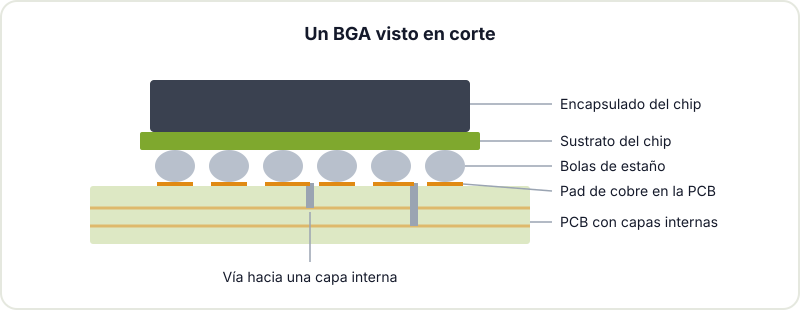
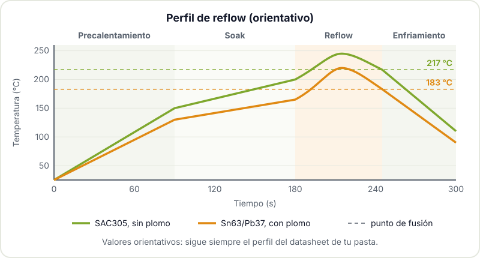
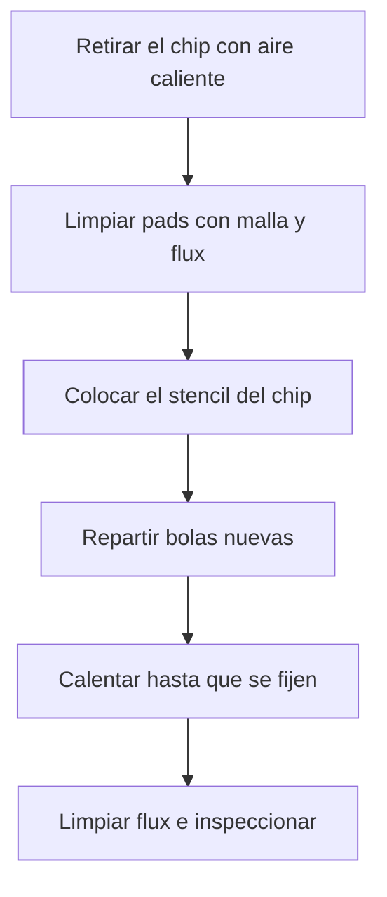
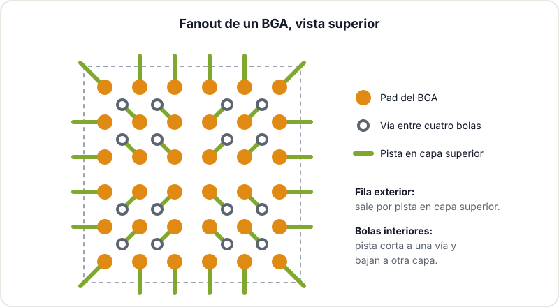

Hay chips que no tienen patillas a la vista. Les das la vuelta y aparece una rejilla de bolitas de estaño: es un BGA (Ball Grid Array). Memorias, procesadores de aplicación, FPGAs y muchos SoC modernos solo se fabrican así. Para un maker, el BGA suele ser la frontera: lo que hay más allá ya no se suelda con soldador. Eso no significa que sea imposible, pero sí que conviene saber qué implica antes de meter uno en tu diseño.

## Qué es un BGA

En un BGA, los contactos del chip están en la cara inferior, organizados en una matriz de filas y columnas. Cada contacto lleva una bola de estaño que, al fundirse, une el chip con su pad en la PCB. Comparado con un QFP, que reparte las patillas en el perímetro, el BGA aprovecha toda la superficie del encapsulado:

- **Muchas más conexiones en menos espacio.** Un chip de 10 x 10 mm puede tener cientos de bolas.
- **Mejor comportamiento eléctrico y térmico.** Los caminos son cortos y el calor sale hacia la placa.
- **Autoalineación.** Al fundir, la tensión superficial de las bolas centra el chip sobre sus pads.

El inconveniente es evidente: las uniones quedan debajo del chip, donde no llega la punta del soldador y no se ve nada. La entrada de Wikipedia sobre [Ball Grid Array](https://es.wikipedia.org/wiki/Ball_grid_array) tiene más detalles de la historia y las variantes.

## Por qué no se suelda con soldador

Con un soldador solo puedes calentar lo que tocas. En un BGA, las bolas interiores están a varios milímetros del borde y no hay forma de llegar a ellas. Hace falta calentar el chip entero y la zona de la placa de forma uniforme hasta que todas las bolas fundan a la vez, y después dejar que se enfríen sin que nada se mueva. Eso solo se consigue con:

- **Horno de reflow**, la opción más controlada.
- **Estación de rework con aire caliente y precalentador inferior.** El precalentador calienta la placa desde abajo para que el aire de arriba no tenga que hacer todo el trabajo, lo que reduce el riesgo de deformar la PCB o quemar el chip.
- **Placa calefactora** en placas pequeñas, con más dificultad para controlar el perfil.

## El perfil térmico de reflow

Soldar por reflow no es "calentar hasta que funda". La pasta y las bolas siguen un perfil de temperatura en el tiempo, con cuatro fases. El de cada pasta lo da el fabricante en su datasheet, y es lo que debes seguir. La forma general es esta:

1. **Precalentamiento.** Subida gradual, del orden de 1 a 3 °C por segundo, para que la placa y los componentes se calienten sin choques térmicos.
2. **Soak (estabilización).** Una meseta, del orden de 150 a 200 °C en pastas sin plomo, para que toda la placa iguale temperatura y el flux se active y limpie los óxidos.
3. **Reflow.** Pico por encima del punto de fusión. Como orientación, en SAC305 (funde hacia 217 a 220 °C) el pico suele estar en torno a 235 a 250 °C, y en Sn63/Pb37 (funde a 183 °C) en torno a 205 a 225 °C. El tiempo por encima de la fusión suele ser de unas decenas de segundos.
4. **Enfriamiento.** Controlado, sin forzarlo, para que las uniones solidifiquen con buena estructura.

La página de Wikipedia sobre [soldadura por reflow](https://en.wikipedia.org/wiki/Reflow_soldering) explica cada zona con más detalle. Lo importante es que con un BGA el margen de error es pequeño: si no llegas al pico, alguna bola no funde; si te pasas, dañas el chip o la placa se combea.

## Reballing con stencil

Cuando retiras un BGA (para reutilizarlo o porque estaba mal soldado), se queda con restos irregulares de estaño en lugar de bolas. Para volver a soldarlo hay que hacer reballing:

1. Limpia los pads del chip con flux y malla desoldadora hasta dejarlos planos.
2. Aplica una capa fina de flux pegajoso.
3. Coloca un stencil específico para ese encapsulado: una lámina con un agujero por bola.
4. Reparte bolas nuevas del diámetro correcto sobre el stencil, de modo que cada agujero quede con una.
5. Calienta con aire caliente hasta que las bolas se fundan y se unan a sus pads.
6. Retira el stencil, limpia el flux e inspecciona que todas las bolas estén y sean del mismo tamaño.

También hay quien hace reballing con pasta en lugar de bolas sueltas. Funciona, pero las bolas suelen salir menos uniformes. La entrada de Wikipedia sobre [reballing](https://en.wikipedia.org/wiki/Reballing) resume el proceso y sus usos en reparación.

## Inspección: cómo saber si ha salido bien

En industria, los BGA se inspeccionan con rayos X: se ven las bolas a través del chip y se detectan puentes, bolas que faltan o huecos (voids) dentro del estaño.


 En un taller maker no hay rayos X, así que toca combinar otras pistas:

- **Mirar por el borde.** Con lupa o microscopio y luz rasante se ven las filas exteriores. Deben tener forma de barril aplastado, todas iguales y el chip debe quedar paralelo a la placa.
- **Comprobaciones eléctricas.** Medir continuidad o resistencia a masa en puntos de prueba, buscar cortocircuitos entre alimentaciones antes de enchufar nada.
- **Boundary scan (JTAG)**, si el chip lo soporta y tienes la herramienta: comprueba conexiones sin necesidad de rayos X.
- **Prueba funcional.** En el fondo, lo definitivo es que el circuito arranque y pase sus pruebas.

## Diseñar para BGA en KiCad

Si vas a usar un BGA, buena parte del éxito se decide en el diseño. Algunas pautas que aplican en [KiCad](https://docs.kicad.org/) y en cualquier herramienta:

- **Usa el footprint recomendado por el fabricante del chip**, con el tamaño de pad que indica su datasheet. KiCad trae muchos en sus librerías, pero revísalo siempre contra ese documento.
- **Planifica el fanout.** Las filas exteriores se pueden sacar con pistas en la capa superior; para las interiores necesitas vías. El patrón típico es "dog bone": una pista corta del pad a una vía situada entre cuatro bolas.
- **Mira el paso.** Con pasos de 1 mm o 0,8 mm se puede hacer fanout con vías normales y cuatro capas. Pasos más finos suelen pedir vías en el propio pad (via-in-pad) rellenas y tapadas, que encarecen la placa.
- **No dejes vías abiertas junto a los pads**, porque pueden robar estaño durante el reflow. Tápalas con máscara (tenting).
- **Comprueba las capacidades del fabricante**: pista mínima, separación y tamaño de vía. Revisa también la [checklist de fabricación de PCB](/blog/checklist-fabricacion-pcb/) antes de enviar.
- **Añade fiduciales** si la placa la va a montar una máquina.

## Cuándo es mejor encargar el montaje

Para casi cualquier maker, la respuesta honesta es: si tu diseño lleva un BGA, encarga al menos ese componente montado. Los fabricantes de PCB habituales ofrecen montaje (PCBA) para tiradas pequeñas, con hornos de reflow y, en muchos casos, inspección por rayos X. Consulta sus [capacidades de montaje](https://jlcpcb.com/capabilities/pcb-assembly-capabilities) antes de cerrar el diseño, porque condicionan pasos y tamaños.

Tiene sentido hacerlo tú cuando:

- Es una reparación o una placa ya montada a la que hay que cambiar un chip.
- Quieres aprender la técnica y tienes placas de práctica que puedes perder.
- El BGA es grande (paso de 1 mm o más) y tienes acceso a una estación de rework con precalentador.

Para todo lo demás, el camino eficiente es diseñar bien, pedir la placa montada y dedicar tu tiempo al resto del proyecto. Si vienes de kits y montajes through-hole, en [del kit a la PCB propia](/blog/del-kit-a-la-pcb-propia/) contamos cómo dar ese salto, y si quieres repasar las técnicas previas, tienes [empezar a soldar](/blog/empezar-a-soldar/) y [soldar componentes SMD a mano](/blog/soldar-smd/). Más material en [recursos de electrónica para makers](/blog/recursos-electronica-makers/).

¿Estás pensando en meter un BGA en tu próxima placa, o tienes uno que reparar? Pásate por el Hackerspace Valencia y lo hablamos con el diseño delante: muchas veces la mejor decisión se toma antes de abrir KiCad.

## Créditos de imágenes

- **Portada** - *BGA package cross section* - TubeTimeUS - CC BY-SA 4.0 - [fuente](https://commons.wikimedia.org/wiki/File:BGA_package_cross_section.jpg)
- **Rayos X de un BGA** - *BGA joint xray* - DJGB - Dominio público - [fuente](https://commons.wikimedia.org/wiki/File:BGA_joint_xray.jpg)
