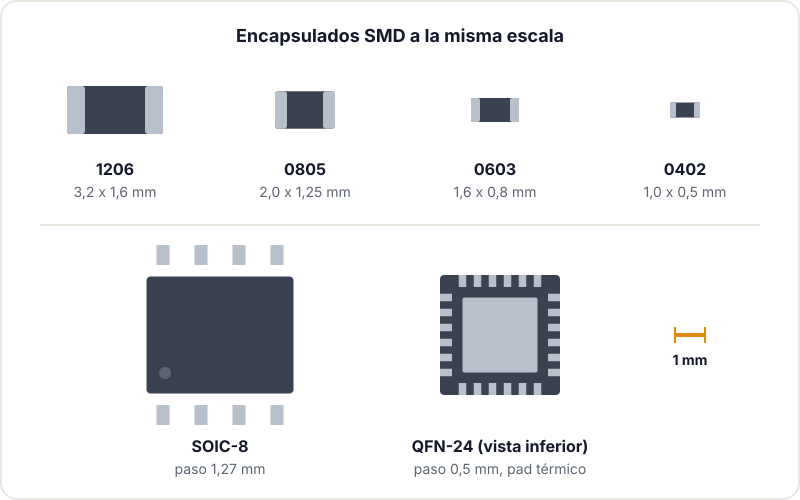
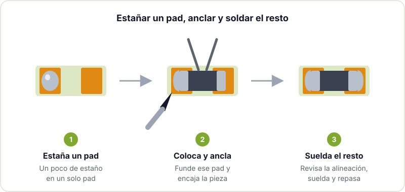

Tarde o temprano todo proyecto se topa con un chip que solo existe en montaje superficial (SMD): un sensor I2C, un regulador pequeño, el propio módulo ESP32. La primera reacción suele ser buscar la versión en placa de breakout, pero soldar SMD a mano es bastante más asequible de lo que parece. Con flux, buena luz y algo de paciencia, un 0805 o un SOIC se sueldan con el mismo soldador que usas para through-hole. Si aún no tienes soltura con lo básico, empieza por [empezar a soldar](/blog/empezar-a-soldar/) y vuelve aquí después.

## Tamaños de encapsulado

Lo primero es saber a qué te enfrentas. En pasivos (resistencias, condensadores) el nombre del encapsulado indica el tamaño. Ojo: el código habitual es imperial (en centésimas de pulgada) y existe también un código métrico que usa los mismos dígitos con otro significado, así que conviene mirar siempre las dos columnas.

| Imperial | Métrico | Tamaño aprox. | A mano |
|---|---|---|---|
| 1206 | 3216 | 3,2 x 1,6 mm | Muy fácil, ideal para empezar |
| 0805 | 2012 | 2,0 x 1,25 mm | Fácil, el estándar maker razonable |
| 0603 | 1608 | 1,6 x 0,8 mm | Asequible con pinzas finas y lupa |
| 0402 | 1005 | 1,0 x 0,5 mm | Difícil, mejor con microscopio |

En integrados, lo que importa es el paso entre patillas (pitch) y si las patillas se ven o quedan debajo del chip:

- **SOIC**: patillas en ala de gaviota a los dos lados, paso de 1,27 mm. El más amable para empezar.
- **SSOP / TSSOP**: como el SOIC pero más prieto, típicamente 0,65 mm. Se hace bien con drag soldering.
- **QFP / LQFP**: patillas a los cuatro lados, con pasos de 0,8 a 0,4 mm según el chip. Es el encapsulado típico de muchos microcontroladores.
- **QFN**: sin patillas visibles, los contactos están en el borde inferior y suele llevar un pad térmico central. Pide aire caliente o pasta y calor desde abajo.

Si diseñas tu propia placa, elegir 0805 y SOIC cuando el proyecto lo permite te ahorra muchos disgustos al montar. El tamaño solo merece la pena reducirlo cuando de verdad falta sitio.

## Lo que necesitas además del soldador

- **Flux, mucho flux.** Es el ingrediente más importante en SMD. Un flux en gel "no clean" en jeringa se queda en su sitio y dura más que el líquido. Con flux, el estaño se reparte solo y los puentes desaparecen; sin él, todo se convierte en bolas.
- **Pinzas finas.** Rectas o curvas, antimagnéticas si puedes. Un 0603 salta de unas pinzas malas y no lo vuelves a ver.
- **Una punta adecuada.** Para SMD funciona muy bien una punta de cincel pequeña (1 a 2 mm) o una de tipo "mini wave" con hueco para drag soldering. La cónica muy fina es peor de lo que parece.
- **Estaño fino.** Hilo de 0,3 a 0,5 mm para no ahogar los pads.
- **Malla desoldadora** de buena calidad, para limpiar puentes y sobrantes.
- **Aumento.** Una lupa de mesa con luz vale para 1206 y 0805. Para 0603 y pasos finos, una lupa binocular o un microscopio estéreo cambian la experiencia por completo, sobre todo para inspeccionar después. Los microscopios USB sirven para revisar, pero la falta de profundidad hace incómodo soldar mirando la pantalla.
- **Alcohol isopropílico** y un cepillo para limpiar los restos de flux al terminar.



## Técnica 1: estañar un pad, anclar y soldar el resto

Es el método más útil y sirve para casi todo lo que tiene patillas visibles: resistencias, condensadores, SOIC, SOT-23 e incluso QFP.

1. **Estaña un solo pad.** Pon una pequeña cantidad de estaño en uno de los pads (en un integrado, en un pad de una esquina).
2. **Coloca y ancla.** Sujeta el componente con las pinzas, acerca el soldador a ese pad estañado y desliza la pieza hasta su posición mientras el estaño está líquido. Retira el soldador y mantén las pinzas un segundo.
3. **Comprueba la alineación.** Antes de seguir, mira que el componente está plano y centrado. En un integrado, comprueba que todas las patillas caen sobre sus pads y que el pin 1 está donde debe. Si no, recalienta el pad anclado y corrige. Ahora todavía es fácil.
4. **Suelda el resto.** El otro extremo de la resistencia, o la esquina opuesta del integrado para fijarlo bien, y luego el resto de patillas.
5. **Repasa el primer pad.** Añade un toque de flux y recaliéntalo, porque la soldadura de anclaje suele quedar con poco flux.

## Técnica 2: drag soldering para pasos finos

Para TSSOP o QFP no hace falta soldar patilla a patilla. Una vez anclado el chip por dos esquinas opuestas:

1. Cubre toda la fila de patillas con flux generoso.
2. Carga la punta con una gota de estaño.
3. Arrastra la punta despacio a lo largo de la fila, tocando el extremo de las patillas. La tensión superficial y el flux reparten el estaño en cada patilla y dejan los huecos limpios.

Si queda algún puente, no pasa nada: más flux y otra pasada, o malla desoldadora. Es más rápido y deja uniones más uniformes que ir una a una.

## Técnica 3: aire caliente

Una estación de aire caliente es casi obligatoria para QFN, para retirar componentes y para piezas con pad térmico debajo. El proceso:

1. Estaña ligeramente los pads (o pon un poco de pasta) y añade flux.
2. Coloca el componente.
3. Calienta en círculos con la boquilla a unos centímetros, con caudal de aire bajo para no soplar los pasivos vecinos. Verás el momento en que el estaño funde: el chip "flota" y se autoalinea por tensión superficial.
4. Retira el calor y deja enfriar sin tocar.

Protege los componentes de plástico cercanos (conectores, botones) con cinta de poliimida o papel de aluminio. Y ten en cuenta que el aire caliente afecta a todo lo que hay alrededor, no solo a la pieza que quieres soldar.

## Técnica 4: pasta de soldar y placa calefactora u horno

Para placas enteras, sobre todo si llevas varias unidades, la forma más limpia es la misma que en industria: pasta de soldar aplicada con un stencil (plantilla metálica que puedes pedir junto con la PCB), componentes colocados con pinzas y calor uniforme para fundirlo todo a la vez.

- **Placa calefactora (hot plate).** Calienta la PCB desde abajo. Funciona muy bien con placas de una cara y es fácil ver el momento en que la pasta funde.
- **Horno de reflow.** Hornos comerciales pequeños o tostadores modificados con controlador de temperatura. Siguen un perfil de temperatura controlado, algo que contamos en detalle en el artículo sobre [soldar BGA](/blog/soldar-bga/).

Con pasta, la cantidad la decide el stencil y el resultado suele ser más uniforme que a mano. Sin stencil, puedes aplicar la pasta con jeringa, pero cuesta dosificar y se forman más puentes.

## Retirar puentes y exceso de estaño

Los puentes entre patillas son el error más común en SMD y el más fácil de arreglar:

1. Añade flux sobre el puente.
2. Apoya la malla desoldadora encima y presiona con la punta del soldador.
3. Cuando la malla absorba el estaño, retira malla y soldador juntos, en vertical. Si retiras solo el soldador, la malla se queda soldada a la placa.

Muchas veces basta con flux y pasar la punta limpia, sin malla: el estaño sobrante se queda en la punta. Al terminar, limpia la placa con alcohol isopropílico e inspecciona con aumento. Un puente invisible a simple vista puede costarte una tarde de depuración.

## Para seguir

Si estás preparando tu primera placa con SMD, la [checklist de fabricación de PCB](/blog/checklist-fabricacion-pcb/) te ayuda a no olvidar nada antes de pedirla, y en [del kit a la PCB propia](/blog/del-kit-a-la-pcb-propia/) contamos el salto de montar kits a diseñar. La [documentación de KiCad](https://docs.kicad.org/) explica cómo generar la capa de pasta para pedir el stencil, y la página de Wikipedia sobre [tecnología de montaje superficial](https://en.wikipedia.org/wiki/Surface-mount_technology) recoge los encapsulados más comunes. Más material en [recursos de electrónica para makers](/blog/recursos-electronica-makers/).

¿Tienes una placa con SMD esperando en un cajón? Tráela al Hackerspace Valencia y la montamos juntos: lo normal es que la primera resistencia cueste diez minutos y la décima, treinta segundos.

## Créditos de imágenes

- **Portada** - *Surface Mount Devices* - Mister rf - CC BY-SA 4.0 - [fuente](https://commons.wikimedia.org/wiki/File:Surface_Mount_Devices.jpg)
- **Microscopio estéreo** - *Soldering Surface-mount components with a Stereo microscope* - Brandon Stafford - CC BY-SA 2.0 - [fuente](https://commons.wikimedia.org/wiki/File:Soldering_Surface-mount_components_with_a_Stereo_microscope.jpg)
