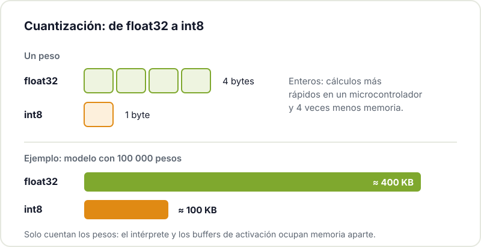

Cuando se habla de inteligencia artificial casi siempre se piensa en centros de datos y en modelos enormes como los que explicamos en [qué es la IA generativa](/blog/que-es-la-ia-generativa/). Pero hay otra rama que va en la dirección contraria: meter modelos pequeños y muy concretos dentro de un microcontrolador de pocos euros, con unos cientos de kilobytes de RAM y alimentado por una batería. A eso se le llama **TinyML**.

Para un maker esto abre posibilidades muy prácticas: un sensor que no se limita a medir, sino que decide si lo que mide es normal; un mando que reconoce gestos; un aparato que se despierta al oír una palabra concreta. Todo sin enviar datos a ningún servidor.

## Qué es TinyML (y qué no es)

TinyML es aprendizaje automático ejecutado en microcontroladores con recursos muy limitados. La idea importante es que **el microcontrolador no aprende**: el modelo se entrena en tu ordenador (o en la nube) con herramientas como TensorFlow o PyTorch, se reduce y se convierte a un formato ligero, y solo entonces se carga en el firmware. El chip se limita a hacer *inferencia*: recibir datos y devolver una predicción.

Tampoco es una forma de meter un chatbot en un ESP32. Los modelos de TinyML ocupan kilobytes, no gigabytes, y resuelven tareas acotadas: clasificar, detectar anomalías, reconocer unas pocas palabras.

## Por qué procesar en el propio dispositivo

El esquema clásico de IoT es que el sensor envía todo a un servidor y allí se analiza. Funciona, pero tiene costes: la radio es lo que más gasta en un dispositivo con batería, la conexión no siempre está, y mandar audio o vibraciones en bruto a otro sitio plantea dudas de privacidad. Si el propio microcontrolador decide, solo hace falta transmitir el resultado ("la impresora ha hecho un ruido raro"), o nada. Si te interesa la parte energética, en [cómo reducir el consumo del ESP32](/blog/consumo-esp32/) tienes las técnicas de base.

## TinyML frente a Edge AI

Los dos términos se confunden a menudo. Edge AI es cualquier IA que se ejecuta cerca de donde se generan los datos; TinyML es el extremo más pequeño de esa familia. Todo TinyML es Edge AI, pero no al revés.

| | TinyML | Edge AI en general |
|---|---|---|
| Hardware típico | Microcontroladores: ESP32, ESP32-S3, RP2040, STM32 | Además: Raspberry Pi, Jetson, móviles, mini PCs con acelerador |
| Memoria disponible | Cientos de KB a pocos MB | Desde cientos de MB hasta varios GB |
| Consumo | Miliamperios, apto para batería durante meses | Vatios, normalmente con alimentación fija |
| Sistema operativo | Ninguno o un RTOS | Normalmente Linux |
| Tamaño de modelo | Kilobytes | Megabytes o más |
| Ejemplos | Palabra clave, gestos, anomalías en vibraciones | Detección de objetos en vídeo, modelos de lenguaje pequeños |

## El flujo de trabajo

Un proyecto TinyML sigue casi siempre las mismas fases:

1. **Recoger datos** reales, con el mismo sensor y en las mismas condiciones en que funcionará. Es la fase más importante y la que más se subestima: un modelo entrenado con datos de laboratorio fallará en el taller.
2. **Entrenar** un modelo pequeño en el ordenador.
3. **Reducirlo**: cuantización, poda de parámetros o una arquitectura más simple.
4. **Integrarlo** en el firmware, normalmente como un array de bytes en C.
5. **Validar** en la placa real: precisión, tiempo de inferencia, memoria y consumo.

### La cuantización, explicada

La técnica que más ayuda es la cuantización: pasar los pesos del modelo de números de coma flotante de 32 bits a enteros de 8 bits. Cada peso ocupa una cuarta parte, los cálculos con enteros son más rápidos en un microcontrolador y, bien hecha, la pérdida de precisión suele ser pequeña.

## Qué hardware usar

- **ESP32**: la puerta de entrada. Barato, con WiFi y Bluetooth, y suficiente para modelos sencillos con acelerómetros o sensores lentos. Si nunca has usado uno, empieza por [empezar con el ESP32](/blog/empezar-con-esp32/).
- **ESP32-S3**: añade instrucciones vectoriales pensadas para acelerar redes neuronales. Es la opción habitual para audio y visión sencilla.
- **ESP32-P4**: sin radio pero con mucha más potencia, interfaces de cámara y pantalla. Lo analizamos en [ESP32-P4: el salto de Espressif](/blog/esp32-p4/).
- **Raspberry Pi Pico (RP2040)** y familias **STM32**: buenas alternativas, con mucha documentación.

## Herramientas

- **[LiteRT for Microcontrollers](https://developers.google.com/edge/litert/microcontrollers/overview)** (antes TensorFlow Lite for Microcontrollers): el intérprete de referencia. No necesita sistema operativo ni memoria dinámica, y tiene ejemplos para ESP32 y Arduino. El código está en el repositorio [tflite-micro](https://github.com/tensorflow/tflite-micro).
- **[Edge Impulse](https://docs.edgeimpulse.com/)**: plataforma web que cubre el ciclo completo: capturas datos desde la placa, entrenas, y te genera una librería lista para Arduino o ESP-IDF. Muy recomendable para el primer proyecto.
- **[ESP-DL](https://github.com/espressif/esp-dl)**: la librería de Espressif, optimizada para ESP32-S3 y ESP32-P4. Cuantiza modelos de PyTorch, TensorFlow u ONNX con su herramienta ESP-PPQ.
- **CMSIS-NN**: núcleos optimizados para Arm Cortex-M, útiles si trabajas con STM32 o RP2040.

## Ideas de proyecto para el taller

### Detectar una palabra clave

El clásico *keyword spotting*: un micrófono I2S y un ESP32-S3 que reconoce "enciende" o "para" sin conexión a Internet. Graba unos cientos de muestras de varias voces (aquí ayuda tener a mucha gente distinta alrededor) y algo de ruido de fondo como clase "nada".

### Gestos con un acelerómetro

Un MPU-6050 en la muñeca o en un mando, y un modelo que distingue tres o cuatro gestos: círculo, sacudida, golpe. Es probablemente el mejor primer proyecto, porque los datos se capturan en minutos y el modelo es diminuto.



### Vigilar una impresora 3D por sus vibraciones

Un acelerómetro pegado al marco de la impresora, unas horas de impresiones normales para aprender el patrón, y un modelo de detección de anomalías que avisa cuando algo vibra distinto: un rodamiento que empieza a fallar, una correa floja o una pieza que se ha despegado. Es mantenimiento predictivo a escala de taller.

### Clasificar sonidos de una máquina

La misma idea con un micrófono: distinguir si el compresor, la fresadora o el extractor suenan como siempre.

## Limitaciones

- **Memoria**: el modelo, el intérprete y los buffers deben caber en la RAM y la flash del chip. Es la restricción que más condiciona.
- **No aprende en el dispositivo**: si cambian las condiciones, hay que volver a entrenar y actualizar el firmware. Aquí viene bien tener [actualizaciones OTA](/blog/actualizaciones-ota-esp32/) preparadas.
- **Los datos mandan**: un modelo pequeño con buenos datos supera a uno ingenioso con datos pobres.
- **No todo encaja**: modelos de lenguaje grandes, vídeo en alta resolución o razonamiento complejo siguen siendo cosa de hardware mayor o de la nube. Muchos proyectos combinan ambos mundos: TinyML filtra y decide en local, y solo lo interesante sube a un servidor.

## Hacia dónde va

Los fabricantes están metiendo aceleradores de IA y extensiones vectoriales (muchas sobre RISC-V) en chips cada vez más baratos. Lo que hoy pide un ESP32-S3 probablemente lo haga cualquier microcontrolador de gama media dentro de poco. Buen momento para aprender el flujo de trabajo.

## Ven a entrenar tu primer modelo

Si quieres probar TinyML, trae una placa y una idea al [Hackerspace Valencia](/blog/que-es-un-hackerspace/). Capturar datos de gestos o de voz es mucho más fácil con varias personas alrededor, y entre todos es más fácil depurar por qué el modelo confunde un círculo con una sacudida. Y si quieres seguir viniendo, [hazte socio o socia](/pages/alta/).

## Créditos de imágenes

Los diagramas son originales del Hackerspace Valencia. Las fotografías proceden de [Wikimedia Commons](https://commons.wikimedia.org):

- **Portada** - *ESP32-S3 on paper* - VectorVoyager - CC BY-SA 4.0 - [fuente](https://commons.wikimedia.org/wiki/File:ESP32-S3_on_paper.jpg)
- **Módulo MPU-6050** - *GY-521 MPU-6050 Module 3 Axis Gyroscope + Accelerometer* - Nevit Dilmen - CC BY-SA 3.0 - [fuente](https://commons.wikimedia.org/wiki/File:GY-521_MPU-6050_Module_3_Axis_Gyroscope_%2B_Accelerometer_0487.jpg)
